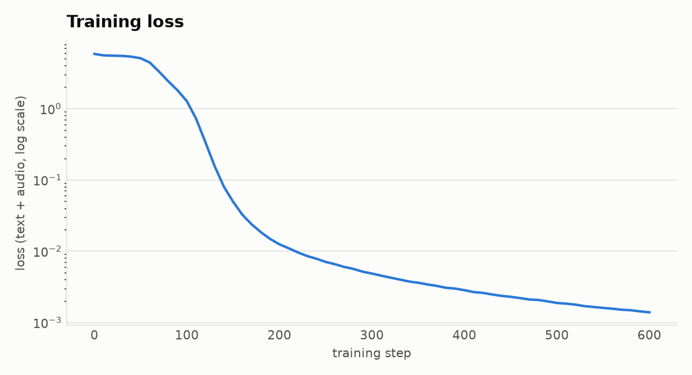

# LilMoshi

I built this to understand [Moshi](https://github.com/kyutai-labs/moshi) 's duplex speech model. It's my own small rebuild of the language model at its core, written from scratch in PyTorch.

## Run it

```bash
uv sync
uv run pytest                   
uv run python train_lilmoshi.py
```

## Training loss



## Differences from Moshi

LilMoshi keeps Moshi's overall structure (a Temporal Transformer across time and a
small Depth Transformer across codebooks) but simplifies almost everything else:

- It's far smaller, with two audio codebooks per speaker instead of eight.
- It uses standard components: LayerNorm, learned positions and a GELU feed-forward
  instead of RMSNorm, RoPE and a gated one.
- It trains on synthetic token rules rather than real speech, so there's no Mimi codec
  and no special tokens.
- There are no stream delays, no KV cache and no real-time streaming.
